<p align="center">
  
</p>

<p align="center">
  <a href="https://github.com/Austin-Joshua/infinitus/actions/workflows/ci.yml"></a>&nbsp;
  <a href="LICENSE"></a>&nbsp;
  <a href="https://infinitus-seven.vercel.app"></a>&nbsp;
  <code>next.js 15</code>&nbsp;
  <code>react 19</code>&nbsp;
  <code>tailwind css</code>&nbsp;
  <code>framer motion</code>
</p>

<p align="center"><b>Live Website:</b> <a href="https://infinitus-seven.vercel.app">infinitus-seven.vercel.app</a></p>

**INFINITUS is the official web portal of the Mathematics Club at Rajalakshmi Institute of Technology, Chennai.**

The hero features a mathematical lemniscate of Bernoulli, plotted point by point and traced by a moving coordinate dot. The site is themed in paper (light) and ink (dark), and the 404 page tends to infinity.

All data lives in bundled JS files (`lib/data.js`), allowing the site to run statically with zero required backend dependencies. Supabase can be connected optionally without changing component logic.


## Pages & Structure

The landing page tours the club and links directly to each dedicated page:

| Page | Description |
|---|---|
| **Home** | Hero lemniscate curve, key stats, ticker marquee, latest events, committee cards, curated Instagram feed, and photo gallery |
| **About** | Club mission, six operational pillars, and timeline from 2023 to 2026 |
| **Events** | 15 hosted events with posters, dates, venues, Instagram links, and Google Form registration hooks |
| **Team** | Core Committee 2026–27 with member cards, roles, and departmental representation |
| **Gallery** | Photo highlights with unique captions and accessible keyboard-navigable modal |
| **Contact** | Official Google Form queries, direct club email, Instagram, and college campus address |

It also ships a link-preview image, a sitemap, `robots.txt`, and read-only
JSON at `/api/members` and `/api/events`.


## Every event, on the wall

<p align="center">
  
</p>

Fifteen events since 2024, from a guest lecture on mathematics in modern
technology to **SHINKA 2026**, a mathematics and innovation championship for
school students. Each poster is a WebP in `public/events/`, and the strip above
is built from the same files.


## How it's wired

<p align="center">
  
</p>

Pages are server components that ask `lib/members.js` and `lib/events.js` for
their data, refreshed every 60 seconds. With no Supabase keys, everything comes
from `lib/data.js`. With keys set, members come from Supabase (falling back to
the bundled roster if the table is empty or the query fails), and Supabase
events are merged in with the bundled ones, newest first. The gallery and the
role responsibilities are always read from the repo.


## Run it locally

You need **Node 18.18+**.

```bash
git clone https://github.com/Austin-Joshua/infinitus.git
cd infinitus
npm install
npm run dev        # http://localhost:3000
```

> [!NOTE]
> No `.env.local` is needed to start. Without Supabase keys the site serves the
> bundled data in `lib/data.js`.

| Script | Description |
|---|---|
| `npm run dev` | Development server at `localhost:3000` |
| `npm run build` | Production build (compiles all static & SSG routes) |
| `npm start` | Serve production build locally |
| `npm test` | Run automated unit test suite (`node --test`) |
| `npm run lint` | ESLint 9 Flat Config verification (`eslint .`) |
| `npm run branding:optimize` | Rebuild `public/brand/` from master logos in `assets/brand/source/` |
| `npm run db:seed` | Seed bundled data into Supabase (offline administrative use) |


## Keeping it up to date

| To… | Edit |
|---|---|
| add an **event** | `EVENTS` in `lib/data.js`, with its poster as a WebP in `public/events/` |
| open **registrations** | set `status: 'upcoming'` and a Google Form `registrationFormUrl` on the event |
| change the **committee** | `MEMBERS` in `lib/data.js` |
| update **role responsibilities** | `INFINITUS_Member_Role_Responsibilities.md`, then mirror it in `lib/roleResponsibilities.js` |
| add **gallery** photos | `GALLERY` in `lib/data.js`, with the image in `public/gallery/` |
| change **site copy** or the nav | `COPY` and `PAGES` in `lib/site.js` |
| swap **logos** | masters in `assets/brand/source/`, then `npm run branding:optimize` |

After adding events or members, run `node scripts/readme/build.mjs` so the
README's numbers and poster strip catch up.

<details>
<summary><b>Project structure</b></summary>
<br>

```
Infinitus/
├── app/                    # Next.js App Router (pages + API)
│   ├── page.jsx            # Homepage
│   ├── about/              # About the club + journey
│   ├── events/             # Events list + [id] detail pages
│   ├── team/               # Core committee / members
│   ├── gallery/            # Photo gallery
│   ├── contact/            # Contact + queries form link
│   ├── api/                # Read-only members / events JSON
│   ├── layout.jsx          # Site metadata + fonts
│   ├── template.jsx        # Page-transition curtain
│   ├── not-found.jsx       # 404 page
│   ├── sitemap.js, robots.js
│   ├── opengraph-image.jsx # Link-preview image
│   ├── icon.svg            # Browser tab favicon
│   └── apple-icon.png
├── assets/
│   └── brand/source/       # Master logo PNGs (not served publicly)
├── public/
│   ├── brand/              # Optimized logos for the website
│   ├── events/             # Event posters
│   └── gallery/            # Gallery photos
├── components/
│   ├── brand/              # InfinitusLogo, RitLogo
│   ├── layout/             # Nav, Footer, Loader, PageHeader
│   ├── sections/           # Page sections (Hero, About, Journey, Events…)
│   │   └── home/           # Homepage-only sections
│   └── ui/                 # Shared UI (cards, browsers, gallery grid, lemniscate, reveal)
├── lib/                    # Site config, data (members, events, gallery), Supabase client
├── scripts/
│   ├── optimize-branding.mjs
│   ├── readme/build.mjs    # Draws the README's animated SVGs
│   └── db/                 # schema.sql, seed.mjs, migrations
├── .github/readme/         # The SVGs on this page
├── docs/                   # Product / design docs + official website content
├── styles/                 # Global CSS + Tailwind
└── INFINITUS_Member_Role_Responsibilities.md  # Source for lib/roleResponsibilities.js
```

</details>

<details>
<summary><b>Environment</b></summary>
<br>

Copy `.env.example` → `.env.local`. Every variable is optional. Without environment variables, the site runs 100% on bundled data.

| Variable | Default | Purpose |
|---|---|---|
| `NEXT_PUBLIC_SITE_URL` | `https://infinitus-seven.vercel.app` | Canonical production URL for metadata, sitemaps, and OpenGraph cards |
| `SUPABASE_URL` | — | Optional Supabase project endpoint |
| `SUPABASE_ANON_KEY` | — | Public client key (enforces Row Level Security on queries) |
| `SUPABASE_SERVICE_ROLE_KEY` | — | Offline database seeding only (`npm run db:seed`). Never commit or deploy. |

</details>

<details>
<summary><b>Database & Security</b></summary>
<br>

Run `scripts/db/schema.sql` and `scripts/db/rls-audit.sql` in the Supabase SQL editor, configure keys in `.env.local`, and run `npm run db:seed` to populate the tables. Public tables enforce read-only policies; all public write mutations are strictly blocked.

</details>

<details>
<summary><b>Rebuilding these animations</b></summary>
<br>

Every image on this page is drawn by `node scripts/readme/build.mjs` from the
site's own data, theme and lemniscate. It uses `sharp` (already a dev
dependency) to embed the logos, posters and photos, and everything moves with
CSS keyframes or SMIL, so GitHub plays it as a plain image.

</details>


## Credits & Contributors

Built by **Aakash B K** (Technical Coordinator / Technical Head, INFINITUS) with **Austin Joshua M** (President, INFINITUS). See [CONTRIBUTORS.md](CONTRIBUTORS.md).

<table>
<tr>
<td width="96"><a href="https://github.com/Austin-Joshua"></a></td>
<td><b>Austin Joshua M</b> · <a href="https://github.com/Austin-Joshua">@Austin-Joshua</a><br>President, INFINITUS 2026–27.<br>Leads the club and repository maintainer.</td>
<td width="96"><a href="https://github.com/Aakashxnoir"></a></td>
<td><b>Aakash B K</b> (Aakash Buddha Kannan) · <a href="https://github.com/Aakashxnoir">@Aakashxnoir</a><br>Technical Head / Technical Coordinator, INFINITUS 2026–27.<br>Built the website architecture and design foundation.</td>
</tr>
</table>

## Policy & Brand Notice

- **Security:** Sourced according to RFC 9116 at [security.txt](public/.well-known/security.txt). Review [SECURITY.md](SECURITY.md) for vulnerability disclosure.
- **Brand & Content:** Sourced under [NOTICE.md](NOTICE.md). INFINITUS emblems, logos, posters, and member photography are all rights reserved to the club.

<p align="center">
  
</p>

**INFINITUS** · Mathematics Club, Rajalakshmi Institute of Technology, Chennai ·
[infinitus@ritchennai.edu.in](mailto:infinitus@ritchennai.edu.in) ·
[Instagram](https://www.instagram.com/infinitus_club.rit/)
